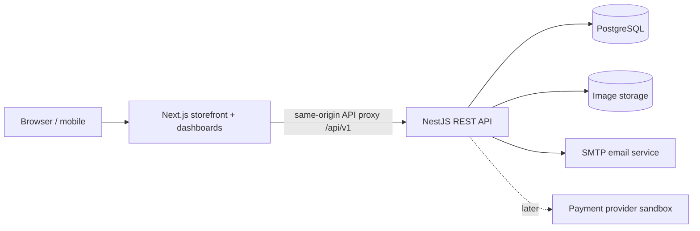

# ScentVault — Full-Stack Web Technologies Project Blueprint (V1)

**Status:** Architecture and initial data model designed; application not yet implemented or deployed.

## 1. Product vision and scope

ScentVault is a responsive single-store perfume e-commerce platform for Bangladesh. It sells sealed bottles and measured fragrance decants. Customers discover fragrances, select a volume, place and track orders, and review products. Staff manage the catalog, stock lots, and fulfillment; administrators manage permissions, discounts, reporting, and audit logs.

- **Business model:** One store / one inventory owner in V1. Staff are store employees, not independent merchants.
- **Currency:** BDT. Store every amount as an integer number of *poisha* (100 poisha = 1 BDT); never use floats for money.
- **Volume:** integer milliliters. Configure offer sizes per fragrance (example: 2, 3, 5, 10 mL decants and 50, 100 mL full bottles).
- **Language:** English UI in V1, Bangla translation can be added later.
- **Target:** Mobile-first responsive web. A PWA or native mobile app is out of scope in V1.
- **Access:** Guest browsing, authenticated cart/checkout/reviews; no guest checkout in V1.
- **Payments:** Cash on delivery with admin-managed fulfillment, plus mocked/sandbox payments for demos. No live gateway or live payment collection without credentials and verification.

### In scope for V1

1. Public storefront (home, catalog, search, filters, fragrance detail, about, FAQ, contact pages).
2. Account registration, email/password login, logout, password reset and verified email flows.
3. Role-based access: CUSTOMER, STAFF, ADMIN.
4. Product catalog: brand, scent family, concentration, notes by layer, gallery, unique slug.
5. Volume-based variants: sealed full bottles and decants, each with SKU and BDT price.
6. Cart, wishlist, saved shipping addresses, checkout, order confirmation and history.
7. Discount coupons, order totals, shipping charges (configurable fixed rates by city/zone in code for V1).
8. Cash-on-delivery or simulated test payment states.
9. Staff catalog and image management, inventory receiving and transfers, order processing, shipment tracking fields.
10. Reviews from verified purchasers, moderated prior to publishing.
11. Admin dashboard: gross sales, orders, top fragrances, low stock, staff actions, coupons.
12. Audit trail for important catalog, inventory, order and role changes.
13. Validation, rate limits, logging, backend authorization, automated tests, and API docs.

### Outside V1 (potential V2)

Multi-vendor onboarding/commissions/payouts; social login; genuine live bKash/Nagad/SSLCommerz payments; courier API synchronization; international shipping; AI-generated recommendations; live chat; loyalty points; multi-warehouse inventory. All require additional design or provider credentials.

## 2. Users and permissions

| Ability | Guest | Customer | Staff | Admin |
|---|---:|---:|---:|---:|
| Browse and filter catalog | Yes | Yes | Yes | Yes |
| Cart, wishlist, place order | No | Yes | Yes (as customer) | Yes (as customer) |
| View own orders/addresses | No | Yes | Yes | Yes |
| Review purchased fragrance | No | Yes | Yes (if purchased) | Yes (if purchased) |
| Edit catalog / upload images | No | No | Yes | Yes |
| Receive stock and prepare decants | No | No | Yes | Yes |
| Process all store orders | No | No | Yes | Yes |
| Manage accounts and staff roles | No | No | No | Yes |
| Change prices, coupons, shipping policy | No | No | No | Yes |
| Global reports and audit logs | No | No | Limited summary | Yes |

An account can hold only one V1 role. Every protected action must be checked server-side. Scope a customer's resources by authenticated user ID.

## 3. Architecture

**Monorepo with two separately running applications:**

- `apps/web`: Next.js App Router + TypeScript, Tailwind, shadcn/ui, React Hook Form, Zod, TanStack Query where useful.
- `apps/api`: NestJS + TypeScript, controllers, DTO validation, services, Prisma ORM 7, PostgreSQL.
- `apps/api/prisma/schema.prisma`: initial data model; `apps/api/prisma.config.ts` will hold database connection configuration during implementation.
- `packages/contracts` (planned): shared API schemas/types; do not share ORM models directly with the UI.
- `docs`: API contract, ERD and implementation notes.

### Architecture flow



Authentication: opaque random session token in Secure, HttpOnly, SameSite cookie; only its cryptographic hash resides in `AuthSession`. Rotate sessions at login / privilege changes, revoke on logout and password reset; protect cookie-authenticated mutations against CSRF, validate Origin, and set appropriate headers. Use a same-origin `/api/v1` reverse proxy to avoid fragile cross-site cookies. Host all services over HTTPS in production. Strong password hashing (Argon2id), generic credential errors, rate limits and email verification are required.

Deploy targets will be selected during implementation. Local Docker Compose will provide Postgres; local image uploads may use development storage, with object storage in deployment. Do not commit secrets or real payment credentials.

## 4. Public frontend / pages

- `/` — home, featured brands, new arrivals, decant sizes, best sellers.
- `/shop` — responsive product grid, sort/filter/search, pagination.
- `/fragrances/[slug]` — gallery, brand, notes, descriptions, size/price picker, stock state, reviews.
- `/brands/[slug]` — all offerings by one brand.
- `/cart` — quantity controls and server-revalidated pricing.
- `/checkout` — address, payment choice, order review, confirmation.
- `/login`, `/register`, `/forgot-password`, `/reset-password` — auth.
- `/account`, `/account/addresses`, `/account/orders`, `/account/orders/[id]`, `/wishlist`.
- `/about`, `/faq`, `/contact`, `/shipping-and-returns`, `/privacy`, `/terms`.

### Staff pages

- `/staff` — daily order summary, low-stock alerts.
- `/staff/fragrances` — add/edit/archive fragrance details and images.
- `/staff/variants` — configure full bottles, decant volumes, SKUs and prices where permitted.
- `/staff/inventory` — receive sealed bottles, transfer one bottle to decant source, see volume remaining and stock history.
- `/staff/orders` and `/staff/orders/[id]` — pick/pack/ship workflow.
- `/staff/reviews` — view reviews and report abuse.

### Admin pages

- `/admin` — sales, totals, top products, order and low-stock charts.
- `/admin/users` — change staff roles, disable accounts.
- `/admin/coupons` — create/update coupons and usage rules.
- `/admin/reviews` — approve/reject reviews.
- `/admin/audit-logs` — append-only administrative history.
- `/admin/settings` — store/shipping policy settings (initial version can be code-driven; move to DB when needed).

## 5. PostgreSQL database design

**Executable data model:** see `apps/api/prisma/schema.prisma` (22 models, 14 enums). The Prisma schema defines FK relationships, data types, indexes, and basic unique constraints. It is a **design artifact**, not a migrated database yet.

| Table/model | Key columns / purpose |
|---|---|
| User | id, name, email, passwordHash, role, isActive, timestamps |
| AuthSession | userId, tokenHash, expiresAt, revokedAt |
| Address | userId, recipient, phone, lines, area/city, postalCode, isDefault |
| Brand | name, unique slug, logo, description |
| Fragrance | brandId, name, slug, concentration, family, description, status |
| ProductImage | fragranceId, URL, alt, position |
| ScentNote | unique scent note name |
| FragranceNote | composite join (fragranceId, noteId, TOP/HEART/BASE) |
| ProductVariant | fragranceId, SKU, kind (FULL_BOTTLE/DECANT), volumeMl, priceMinor |
| InventoryLot | fragranceId, kind, batchCode, bottleSizeMl, unitsOnHand, remainingMl |
| InventoryMovement | lotId, optional orderItemId, actorId, adjustment type, signed deltas |
| Cart | one cart per user |
| CartItem | cartId, variantId, quantity; unique pair |
| WishlistItem | userId, fragranceId composite key |
| Coupon | code, type, value, min spend, cap, active/expiry, usage limits |
| Order | orderNo, userId, status, amounts, shipping address snapshot, couponId |
| OrderItem | orderId, variantId, immutable name/SKU/size/price/quantity snapshots |
| StockReservation | orderItemId, lotId, unitsReserved, mlReserved, status, expiration |
| Payment | orderId, method, status, amountMinor, external reference |
| Shipment | one per order, courier, tracking, status and dates |
| Review | userId, fragranceId, rating, text, moderation status |
| AuditLog | actorId, action, targetType, targetId, JSON metadata, timestamp |

### Important relational integrity / application invariants

- Brand 1:N Fragrance; Fragrance 1:N ProductVariant and InventoryLot; Fragrance M:N ScentNote via FragranceNote.
- Customer 1:N Order; Order 1:N OrderItem; OrderItem 1:N StockReservation; each reservation belongs to one stock lot.
- A `FULL_BOTTLE` variant must be fulfilled from a `SEALED_BOTTLE` lot of the same fragrance and same bottle size. Deduct *units*.
- A `DECANT` variant must be fulfilled from a `DECANT_SOURCE` lot of the same fragrance. Deduct `variant.volumeMl * quantity` from *milliliters*.
- A SEALED_BOTTLE lot has `remainingMl = 0`; a DECANT_SOURCE lot has `unitsOnHand = 0`. Both numbers must never be negative.
- Available stock = on-hand stock minus active RESERVED allocations, filtered by appropriate lot/volume.
- Checkout writes order, order items, coupons usage and stock reservations in a single database transaction. Lock applicable stock rows / use retry-on-serialization to prevent overselling.
- On confirmed payment (or COD order acceptance), convert reservations to CONSUMED and subtract on-hand quantities in one transaction; generate inventory movements exactly once. On cancellation before consumption, RELEASE without subtracting; on post-consumption return, inspect and restock using a separate auditable movement only if suitable.
- Unpaid sandbox reservations expire and release; COD reservations follow a defined staff acceptance policy. A worker/job will sweep expired reservations.
- `orderNo`, checkout idempotency keys, payment provider references, and webhook event IDs must be unique to prevent duplicate processing. **Implementation follow-up:** introduce a CheckoutRequest and PaymentWebhookEvent table/migration when checkout and external payments are built; only the payment provider reference is already modeled.
- Store immutable order item and address snapshots; editing a product or customer address must not change old invoices.
- Reject negative amounts, zero/negative quantities, ratings outside 1–5, impossible discount values, and invalid stock adjustments in DTO/service layers (add DB CHECK constraints in SQL migrations for critical invariants).
- A verified-purchase review requires a DELIVERED order containing the corresponding fragrance; one review per user/fragrance in V1.
- Do not store cardholder credentials or raw access tokens. Do not log secrets, passwords, or full payment payloads.

### Example: decant stock conservation

One newly opened 100 mL fragrance bottle becomes one DECANT_SOURCE lot with `remainingMl = 100`.

- Order A: two 5 mL decants => 10 mL consumed.
- Order B: three 10 mL decants => 30 mL consumed.
- Remaining: 100 - 10 - 30 = **60 mL**.

If another customer attempts to purchase 7 x 10 mL, checkout must reject insufficient volume. Concurrent checkouts cannot allocate the same 60 mL twice.

## 6. REST API outline

All routes below are relative to `/api/v1`. JSON responses follow a consistent error structure (status, code, message, field details, requestId). Authenticated routes use cookie sessions, CSRF protection for mutations and role guards.

| Area | HTTP endpoints | Access |
|---|---|---|
| Auth | POST `/auth/register`, `/auth/login`, `/auth/logout`, `/auth/request-password-reset`, `/auth/reset-password`, `/auth/verify-email`; GET `/auth/me` | Mixed |
| Catalog | GET `/brands`, `/brands/:slug`, `/fragrances`, `/fragrances/:slug`, `/fragrances/:slug/reviews` | Public |
| Search | GET `/fragrances?q=&brand=&family=&concentration=&minPrice=&maxPrice=&sort=&page=` | Public |
| Addresses | GET/POST `/me/addresses`; PATCH/DELETE `/me/addresses/:id` | Customer |
| Cart | GET `/me/cart`; POST `/me/cart/items`; PATCH/DELETE `/me/cart/items/:id` | Customer |
| Wishlist | GET `/me/wishlist`; POST/DELETE `/me/wishlist/:fragranceId` | Customer |
| Checkout | POST `/checkout/preview`; POST `/checkout` with `Idempotency-Key` header | Customer |
| Orders | GET `/me/orders`; GET `/me/orders/:id`; POST `/me/orders/:id/cancel` (eligible orders) | Customer |
| Reviews | POST `/fragrances/:id/reviews`; PATCH/DELETE `/me/reviews/:id` | Eligible buyer |
| Staff catalog | POST/PATCH `/staff/fragrances`; POST `/staff/fragrances/:id/images`; POST/PATCH `/staff/variants` | Staff/Admin |
| Staff stock | GET `/staff/inventory`; POST `/staff/inventory/receive`; POST `/staff/inventory/transfer-to-decant`; GET `/staff/inventory/movements` | Staff/Admin |
| Fulfillment | GET `/staff/orders`; GET `/staff/orders/:id`; PATCH `/staff/orders/:id/status`; PATCH `/staff/orders/:id/shipment` | Staff/Admin |
| Administration | GET `/admin/analytics`; GET/PATCH `/admin/users`; CRUD `/admin/coupons`; GET `/admin/audit-logs`; PATCH `/admin/reviews/:id` | Admin |
| Payment simulation | POST `/payments/sandbox/complete` in development only | Development |

**Server rules:** Pagination has caps; search is normalized/sanitized; amount calculations are computed server-side from current prices, not accepted from the browser; mutations validate ownership/role and allowed state transitions.

### Example checkout payload

```json
{
  "addressId": "0d3fb05a-75e0-42b1-8d8f-16b3d1fcf137",
  "paymentMethod": "CASH_ON_DELIVERY",
  "couponCode": "SCENT10",
  "customerNote": "Please call before delivery"
}
```

Cart contents, pricing, taxes (if any) and delivery fees are loaded/calculated on the server rather than trusted from this payload.

## 7. User journeys and business workflows

**Customer:** Landing -> search/filter -> fragrance detail -> choose decant volume -> cart -> sign in -> address -> checkout -> order confirmation -> tracking -> delivered -> review.

**Staff:** Sign in -> receive sealed 100 mL perfume -> update SEALED_BOTTLE lot -> transfer one bottle to DECANT_SOURCE -> set sizes and prices -> accept order -> pick/decant/pack -> enter courier/tracking -> dispatch.

**Admin:** Sign in -> review low stock, revenue/order summary -> manage staff and pricing -> manage coupons -> approve reviews -> audit critical activity.

### Order state machine

`PENDING -> CONFIRMED -> PACKING -> SHIPPED -> DELIVERED`

Cancellation allowed from PENDING/CONFIRMED by policy; return flow initiated after shipment/delivery with staff approval. Never transition DELIVERED directly back to PENDING. Payment status is separate from fulfillment status.

## 8. Suggested monorepo layout

```text
scentvault/
  apps/
    web/
      src/app/
        (store)/
        (auth)/
        account/
        staff/
        admin/
      src/components/
      src/lib/
      public/
    api/
      src/
        auth/
        users/
        brands/
        fragrances/
        inventory/
        cart/
        wishlist/
        checkout/
        orders/
        payments/
        shipping/
        coupons/
        reviews/
        analytics/
        audit/
        common/
      prisma/
        schema.prisma
        migrations/
      prisma.config.ts
  packages/
    contracts/
  docs/
    architecture.md
    api.md
    erd.mmd
  docker-compose.yml
  .env.example
  package.json
  README.md
```

The API modules follow NestJS controller -> service -> Prisma data access; shared authorization/DTO guards live in `common/`.

## 9. Design system / visual direction

- Brand feel: luxury but approachable, crisp typography, mobile-first interactions.
- Colors: charcoal `#141414`, off-white `#F7F5F0`, champagne accent `#C2A875`, muted burgundy `#67363B`.
- Homepage: full-width editorial hero, shop-by-brand, decant-size explainer, bestsellers, reviews, trust/returns section.
- Product cards: high-quality fragrance photo, brand/name, volume/starting price, wishlist, stock state.
- Detail page: product gallery, top/heart/base notes, size selector, quantity, shipping info, review summary.
- Accessibility: keyboard support, semantic labels, contrast checks, error messages, focus indicators and image alt text.
- Responsive breakpoints: prioritize 360–430 px mobile, tablet, desktop; keep admin tables usable on smaller screens.
- Product pictures require appropriate licenses or photos supplied by the store; do not scrape copyrighted brand images blindly.

## 10. Security and quality acceptance criteria

- Passwords use Argon2id hashes; sessions use hashed opaque tokens, secure cookies, revocation and expiration.
- Validate requests with DTOs and global pipes; parameterize queries via Prisma; rate-limit sign-in, reset and checkout.
- Verify email addresses for account recovery; staff/admin provisioning is admin-only (not public registration).
- Apply CSRF protection to state-changing endpoints, security headers, upload file validation and restricted CORS.
- Avoid price manipulation: server calculates totals; all stock/order changes are transactional and idempotent.
- Unit tests: price/discount calculations; stock accounting; order transitions; permissions; coupon eligibility.
- Integration tests: auth -> browse -> cart -> checkout -> reservation -> cancel/confirm; admin stock transfer.
- End-to-end browser tests: customer purchase, staff dispatch, and admin catalog management.
- Test 2 simultaneous orders against the same low-volume decant lot: never oversell.
- Swagger/OpenAPI describes accessible endpoints, error responses and request DTOs.
- CI: lint, typecheck, tests, build and dependency audit.

## 11. Implementation roadmap (sequential milestones)

| Stage | Work | Definition of done |
|---|---|---|
| 1. Foundation | Monorepo, Next.js/NestJS setup, Docker Postgres, Prisma config, migrations, shared errors, Swagger | Both apps boot, DB connects, migrations apply |
| 2. Identity & roles | Register/login/logout, sessions, guards, customer account, addresses | Three roles tested, forbidden routes blocked |
| 3. Catalog & storefront | Brands, fragrances, images, notes, variants, public filters/search, product page | Staff add a fragrance; customer can view/filter it |
| 4. Decant inventory | Sealed bottle receiving, bottle->decant transfer, movements, stock summaries | Accurate units/ml and concurrency tests |
| 5. Shopping workflow | Cart, wishlist, coupons, shipping fees, checkout, stock reservations, order snapshots | Customer places order; overselling prevented |
| 6. Fulfillment & reviews | Staff processing, tracking, cancellation/return logic, verified reviews, mail notifications | End-to-end purchase cycle works |
| 7. Admin & polish | Analytics, permissions, audit, responsive design, SEO, accessibility, error states | Complete admin demo with realistic seed data |
| 8. Test & release | Unit/integration/E2E tests, security review, Docker setup, README, demo data, deployment | Clean install + reproducible run + working demo |

### Priority ordering

**MVP:** Auth + catalog + full bottle/decant variants + inventory + cart + COD checkout + orders + staff fulfillment.

**V1 polish:** Coupons, wishlist, reviews, dashboard analytics, email, detailed history, accessibility/SEO.

**V2:** Live payment/courier integrations, multi-vendor marketplace, recommendation engine.

## 12. Demo and academic evaluation plan

Demonstrate a seeded store with at least 3 brands, 8 fragrances, 2 decant sizes per fragrance, and full bottle inventory. Show:

1. Admin logs in and creates a product and staff account.
2. Staff opens a 100 mL source bottle and activates decant listings.
3. Customer searches, compares sizes, and buys a 5 mL decant.
4. Stock decreases by exactly 5 mL only on accepted COD order / confirmed payment.
5. Concurrent checkout for insufficient mL fails without negative inventory.
6. Staff updates tracking to delivered; customer reviews the verified purchase.
7. Admin dashboard and audit logs reflect the activity.

## 13. Decisions required only for a production launch

Brand assets, actual shop email/phone/address, owned product images, shipping rates, privacy/return policies, live payment provider credentials, domain name, image hosting and transactional email provider. We can implement fully with demo data and safe placeholders before any of these are available.

## 14. Build kickoff

**Next implementation step:** Start Milestone 1 by creating a real `scentvault/` monorepo with working Next.js and NestJS applications, a local PostgreSQL Docker setup, Prisma 7 configuration and first migration. The provided `schema.prisma` is a V1 starting point: it must be validated by Prisma CLI and updated with DB constraints and idempotency models as the checkout modules are built.
